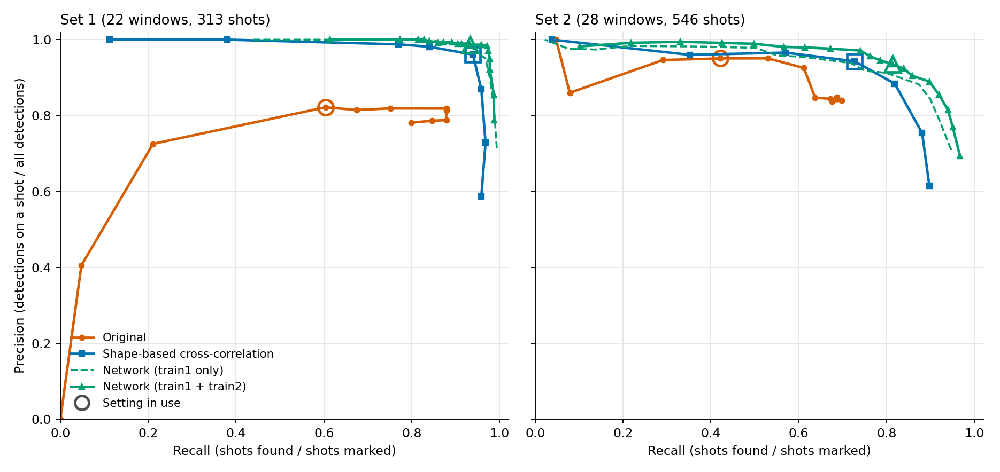
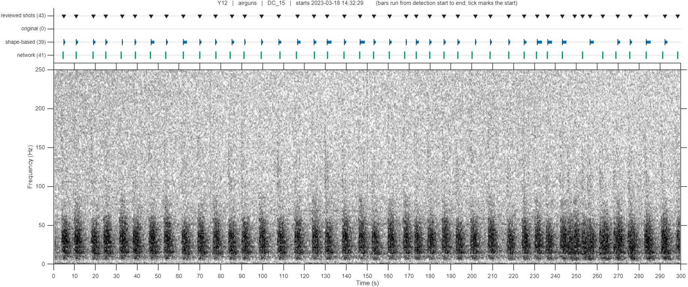
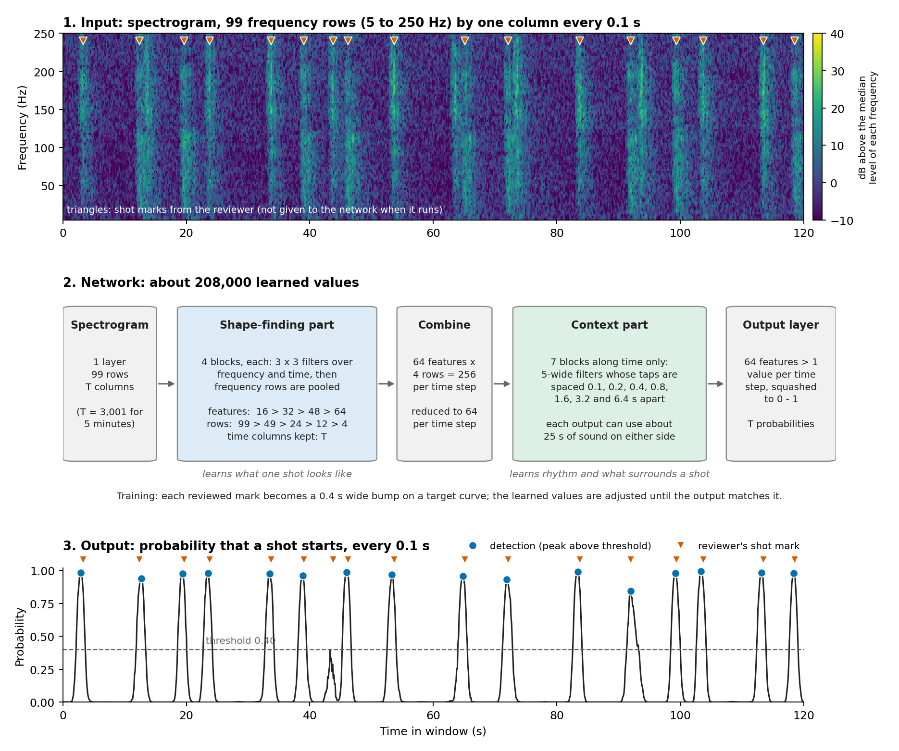

:ocean: Scripps Acoustic Ecology Lab

# Airgun-Detector

Tools for detecting seismic airgun shots in decimated HARP recordings (2 kHz sample rate, `df100` xwavs).

The repository holds three detectors and one shared set of labelled data for comparing them:

| Folder | Detector | How it decides | Language |
|---|---|---|---|
| [`xcorr_original/`](xcorr_original/) | Original cross-correlation detector | Cross-correlates the signal envelope with an airgun template and thresholds how *large* the result is | MATLAB |
| [`xcorr_shape/`](xcorr_shape/) | Shape-based cross-correlation detector | Uses the same template, but scores how well the *shape* matches regardless of loudness, then checks for a regular shot train | MATLAB |
| [`cnn/`](cnn/) | Spectrogram network (CNN) | A small neural network, trained on hand-labelled windows, reads the spectrogram and gives the probability of a shot start every 0.1 s | Python (PyTorch) |
| [`evaluation/`](evaluation/) | Labelled windows, labelling editor, scoring, figures, report | Shared by all three | MATLAB and Python |

All three aim at the same thing: **one detection per airgun shot**. A shot that arrives as several overlapping pulses counts as one shot.

## Results

Scores on three test sets of five-minute windows in which every shot was marked by eye. A shot is *found* if a detection falls within 2 s of it.

| Test set | Shots | Original | Shape-based | Network |
|---|---|---|---|---|
| Set 1: 22 windows chosen to cover known conditions | 313 | 189 found (60%), 41 spare | 294 found (94%), 12 spare | 292 found (93%), 4 spare |
| Set 2: 28 random windows, seven sites | 546 | 230 found (42%), 12 spare | 397 found (73%), 24 spare | 444 found (81%), 31 spare |
| Set 3: 57 random windows at GC_15, MC_17 and DC_15 | 787 | 344 found (44%), 8 spare | 668 found (85%), 28 spare | 672 found (85%), 24 spare |

"Spare" is every detection that holds no marked shot, whether the window has airguns or not.

How to read these numbers:

- **Set 3 is the cleanest comparison.** Its windows were drawn at random, labelled once, and never used to tune or train anything.
- **Sets 1 and 2 favour the shape-based detector**, because its settings were tuned on set 1 and partly on set 2. The network was never trained or tuned on any of the three sets.
- **The original detector misses faint shots and merges close ones.** Its fixed threshold is in raw recording units, and background levels differ by about 15 dB between sites. At DC_15 in set 3 it finds 13 of 265 shots.
- **Data with instrument noise is assumed to be removed before any detector is run.** Two such windows were dropped from set 3.

Precision and recall of each detector as its settings go from strict to lenient (the large open marker is the setting in use):



One five-minute window with the reviewed shots and each detector's output above the spectrogram:



The full write-up, with methods, per-window results and limits, is in [`evaluation/Airgun_detector_report.pdf`](evaluation/Airgun_detector_report.pdf).

## The three detectors

### Original (`xcorr_original/`)

`xcorr_airgun_df100.m` processes each 75 s segment of an xwav:

1. Low-pass at 150 Hz and take the envelope.
2. Cross-correlate with the envelope of a 6 s airgun template (`air_template_df100.mat`) and square the result.
3. A detection is any stretch above the higher of (a) 15% above the segment median and (b) a fixed floor, `minCorrThresh = 7e15`.
4. Five tests on level and duration against the noise before and after; a detection is rejected when two or more fail.

`merge_airguns_one_file.m` groups detections into bouts. The folder also holds the other templates and the helper scripts that came with the detector.

To run: edit `deplList` and `outDisk` at the top of `xcorr_airgun_df100.m`, then run it in MATLAB with Triton's `utFindFiles` on the path.

### Shape-based cross-correlation (`xcorr_shape/`)

`xcorr_airgun_shape.m` keeps the filter, envelope, template and level tests, and changes how shots are found:

- **Shape score.** A correlation coefficient (-1 to 1) between the smoothed envelope and the template, so loudness does not matter. Each peak, at least 2.5 s from the next, is a candidate shot.
- **Acceptance.** A candidate is accepted if its shape score is 0.65 or more, or it is loud, or it stands 8 dB above the noise before it. Weaker candidates (down to 0.40) are kept only if at least three other detections line up with them at a steady spacing of 4 to 40 s.
- **Several arrivals of one shot.** Candidates within 3.5 s are joined into one event.
- **No fixed floor**, so it works across sites with different levels.

To run on a whole deployment:

```matlab
addpath('xcorr_shape')
run_xcorr_shape('GOM_MC_17','E:\AirgunDetections')
```

Output is one `.mat` per xwav with the same variables as the original detector, plus `allTier` and `allCand`.

### Spectrogram network (`cnn/`)



- **Input.** A spectrogram from 5 to 250 Hz (99 rows) with one column every 0.1 s. Each frequency has its median level removed, so the network sees dB above background.
- **Network.** `ShotNet` in `model.py`, about 208,000 learned values: four 2-D convolution blocks that learn what a shot looks like, then seven 1-D convolution blocks along time that give each output about 25 s of context on either side.
- **Output.** The probability that a shot starts, every 0.1 s. Peaks above a threshold and at least 2.5 s apart are the detections. It gives start times only, not durations.
- **Training data.** 234 hand-labelled windows (5,177 shots) in `evaluation/train1` and `evaluation/train2`. The threshold is chosen on a fifth of the training windows that are held back.
- **Ensemble.** Four copies trained from different random starts are averaged (`models/train12_seed1..4.pt`, threshold 0.40).

To train and score (Python 3 with `torch`, `numpy`, `scipy`, `soundfile`):

```bash
cd cnn
python train.py --train train1 train2 --test set1 set2 --epochs 80 --name train12_seed1 --seed 1
python ensemble.py train12_seed set1 set2 set3
```

Not yet written: a script that runs the network over a whole deployment and writes detections in the same format as the other two detectors.

## Labelling and evaluation (`evaluation/`)

| Item | What it is |
|---|---|
| `set1/`, `set2/`, `set3/` | Test sets. Each has `windows.csv` (which stretch of which file), `truth.csv` (the shot marks) `review.csv` (what each window is) and `picks.csv` (the automatic starting marks). The detections and scores behind the results table are kept alongside. |
| `train1/`, `train2/`, `train3/` | Training sets for the network. The network chooses windows it is unsure about, and a person corrects the pooled output of all three detectors. |
| `review_marks.m` | Point-and-click editor for the shot marks: `review_marks('set3')`. |
| `score_detector.m` | Runs either MATLAB detector on a set, unchanged apart from where it reads and writes, and scores it. `score_both_sets.m` runs both on all three test sets. |
| `sweep_pr.m`, `plot_pr.py`, `pr_curve.csv` | Precision-recall curves. |
| `plot_comparison.m`, `plot_methods.m`, `plot_network.py` | Figures. |
| `make_report.py` | Builds `Airgun_detector_report.pdf`. |

The recordings themselves are not in the repository. The scripts read them from `\\frosty.ucsd.edu\GofMX_Decimated_8`.

Only what is needed to label, score and reproduce the figures is kept here. The working files from tuning the shape-based detector, the scripts that drew each set, and the deployment scans that `cnn/select_windows.py` uses to choose new windows are not in the repository.

## Status

- `xcorr_original/` includes three bug fixes that are under review in pull request #2 (milliseconds in segment start times, a one-sample alignment offset, and bout end times).
- The shape-based detector and the network are new and have been tested only on the windows described above, all from Gulf of Mexico deployments.
- The network is still being improved with further rounds of labelling.
